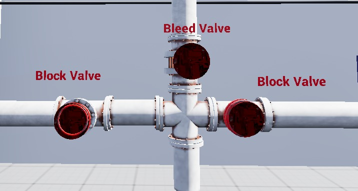
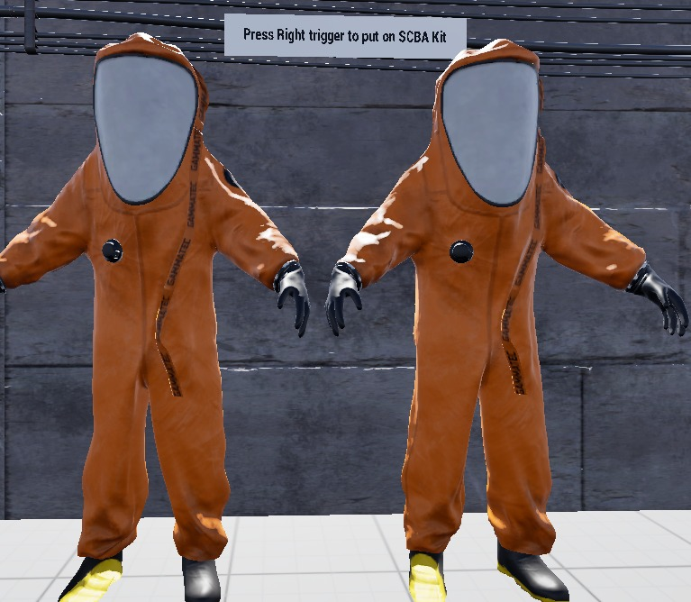
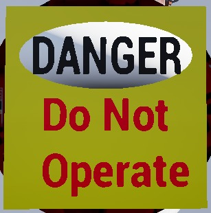
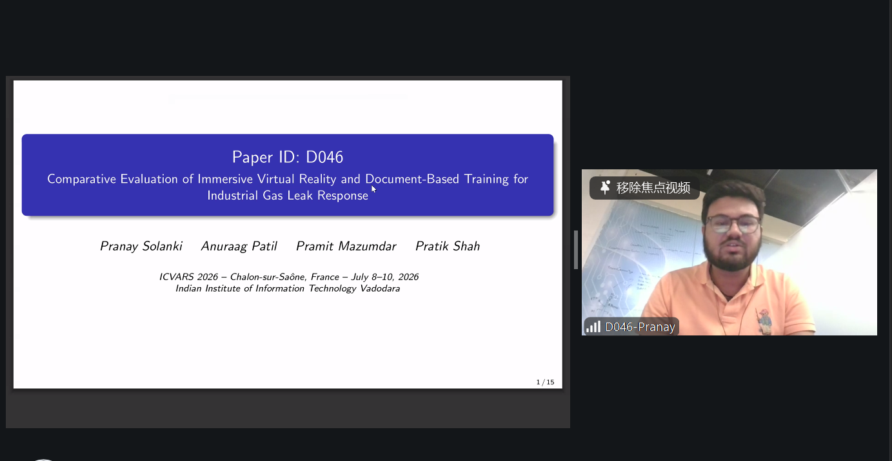

# Comparative Evaluation of Immersive Virtual Reality and Document-Based Training for Industrial Gas Leak Response

**ICVARS 2026 — 10th International Conference on Virtual and Augmented Reality Simulations**  
*Chalon-sur-Saône, France | July 8–10, 2026 | Paper ID: D046*

[](https://www.unrealengine.com/)
[](https://www.meta.com/quest/quest-3/)
[](https://iiitvadodara.ac.in/)
[](https://www.serb.gov.in/)

---

## 📌 Authors & Research Team
- **Pranay Solanki** — *Department of Computer Science & Engineering, IIIT Vadodara* (`202351108@iiitvadodara.ac.in`)
- **Anuraag Patil** — *Department of Computer Science & Engineering, IIIT Vadodara* (`202351100@iiitvadodara.ac.in`)
- **Dr. Pramit Mazumdar** — *Assistant Professor, Department of CSE, IIIT Vadodara* (`pramit.mazumdar@iiitvadodara.ac.in`)
- **Dr. Pratik Shah** — *Associate Professor, Department of ECE, IIIT Vadodara* (`pratik@iiitvadodara.ac.in`)

*Supported by the Anusandhan National Research Foundation (ANRF), Department of Science and Technology, Government of India under project number `CRG/2023/003741`.*

---

## 📖 Executive Summary

Safety-critical operations in natural gas processing facilities demand swift, reliable, and procedural emergency responses. Conventional safety training relies predominantly on text-based Standard Operating Procedures (SOPs), manuals, and verbal classroom lectures. However, static documents fail to recreate emergency stressors (alarms, spatial ambiguity, sensory overload) and lack contextual spatial learning.

This project introduces an **immersive Virtual Reality (VR) guided-learning simulation** replicating a high-risk **Acid Gas Removal Unit (AGRU)** inside an industrial natural gas plant. Learners physically don safety gear, identify gas leaks using multimodal spatial audio and visual particle effects, execute the **Double Block and Bleed (DBB)** protocol, and apply **Lockout-Tagout (LOTO)** safety tags.

### Key Research Findings
In a controlled empirical evaluation with 30 participants (Group A: Document-Based, $n=15$; Group B: VR-Based, $n=15$):
- **Post-Training Accuracy:** VR group achieved **83.11%** vs. **69.33%** for document learners (**+13.78% higher accuracy**).
- **Knowledge Learning Gain:** VR-based framework achieved a **45.77% higher mean learning gain** than the conventional approach (**9.34 points** vs. **6.87 points**; Welch's $t = 2.89, p < 0.01$, large effect size $d = 1.05$, 95% CI $[0.71, 4.22]$).
- **Learner Confidence:** Confidence improved by **2.07 points** on a 5-point Likert scale in the VR group vs. **1.42 points** in the document group (+45% higher confidence gain).
- **Pre-Test Uncertainty:** Participants selected the *"I Don't Know"* option **43.56%** of the time across all participants during baseline pre-tests.

---

## 🖼️ Simulation Media & Visuals

| Double Block and Bleed (DBB) Valve System | SCBA Protective Equipment Donning |
|:---:|:---:|
|  |  |
| *Interactive Double Block & Bleed valve assembly* | *Self-Contained Breathing Apparatus donning station* |

| Lockout-Tagout (LOTO) Safety Protocol | ICVARS 2026 Presentation |
|:---:|:---:|
|  |  |
| *Physical danger lockout tag applied during isolation* | *Online paper presentation at ICVARS 2026* |

---

## 📁 Repository & Drive Assets Reference

| Asset | Description | Location / Link |
|---|---|---|
| **Research Paper PDF** | Full camera-ready conference paper (ICVARS 2026) | [`docs/D046-Final.pdf`](docs/D046-Final.pdf) |
| **Presentation Slides** | 15-slide conference presentation deck | [`docs/D046-Presentation.pdf`](docs/D046-Presentation.pdf) |
| **Project Poster** | High-resolution vertical research poster | [`docs/PortraitPoster.pdf`](docs/PortraitPoster.pdf) |
| **Demonstration Video** | Full HD walkthrough recording (276 MB) | Available in [Institute Google Drive](https://drive.google.com/drive/folders/1KDchY6JpNi2NkI8U5J1P_z0JdWpZ2Ret?usp=sharing) |
| **Simulation Project & Build** | Complete Unreal Engine 5.4 project & standalone build | Available via [Institute Google Drive](https://drive.google.com/drive/folders/1KDchY6JpNi2NkI8U5J1P_z0JdWpZ2Ret?usp=sharing) |
| **Google Drive Archive** | Root demonstration folder for new batches & industry | [Shared Google Drive Folder](https://drive.google.com/drive/folders/1KDchY6JpNi2NkI8U5J1P_z0JdWpZ2Ret?usp=sharing) |

---

## ⚙️ Software & Hardware Requirements

### Hardware Specifications
- **Virtual Reality Headset:** **Meta Quest 3** (Resolution: $2064 \times 2208$ pixels per eye, $110^\circ$ FOV, 6DoF Touch Plus controllers).
- **Workstation / Development PC:**
  - **OS:** Windows 10 / Windows 11 (64-bit)
  - **Processor:** Intel Core i9-13900K or AMD Ryzen 9 7900X equivalent
  - **GPU:** NVIDIA GeForce RTX A5000 (16GB/24GB VRAM) or RTX 3070 / RTX 4070 equivalent
  - **RAM:** 32 GB DDR5 / DDR4 minimum
  - **Storage:** NVMe SSD with at least 80 GB free disk space
  - **Tethering:** High-speed USB-C 3.2 Gen 2 Link Cable or dedicated Wi-Fi 6 / 6E router (AirLink / Virtual Desktop)

### Software & Toolchain
- **Game Engine:** [Unreal Engine 5.4.4](https://www.unrealengine.com/)
- **VR SDK & Plugins:**
  - OpenXR Plugin (Enabled in UE 5.4)
  - Meta XR Plugin for Unreal Engine
  - XR Interaction Toolkit / Enhanced Input System
- **Deployment Tools:**
  - Meta Quest Link App (for PCVR streaming)
  - [Meta Quest Developer Hub (MQDH)](https://developer.oculus.com/developer-hub/) or [SideQuest](https://sidequestvr.com/) (for standalone APK installation)
  - Android ADB (Android Platform Tools)

---

## 🚀 How to Deploy & Demonstrate the Simulation

### Option A: Meta Quest 3 Standalone Deployment (Packaged APK)
*Recommended for quick exhibitions, conferences, and off-site demonstrations.*

1. **Enable Developer Mode** on the Meta Quest 3 headset via the Meta Quest mobile app (Settings → Headset Settings → Developer Mode).
2. Connect the Quest 3 to the workstation using a USB-C data cable. Put on the headset and select **"Allow USB Debugging"**.
3. Install the APK using one of the following methods:
   - **Via SideQuest:** Drag and drop the `.apk` file into the top-right install icon of SideQuest.
   - **Via Meta Quest Developer Hub (MQDH):** Go to *Device Manager → Apps → Install APK*.
   - **Via Command Line (ADB):**
     ```powershell
     adb install -r ICVARS_GasLeak_Training.apk
     ```
4. Put on the headset, navigate to **App Library → Filter (top right) → Unknown Sources**, and launch the simulation.

---

### Option B: PCVR Streaming via Unreal Engine Editor (Best Visual Quality)
*Recommended for lab demonstrations, external monitor viewing, and development.*

1. **Connect Headset:**
   - Connect the Quest 3 to the workstation via a high-speed Link cable or start **Meta Quest Air Link**.
   - Confirm that the Meta Quest PC App status is **Connected (Active)**.
2. **Launch Project:**
   - Open **Unreal Engine 5.4.4**.
   - Open the project file (`.uproject`). Allow shaders to compile on initial run.
3. **Open Level:**
   - In the Content Drawer, navigate to `Content/Maps/` and open the main simulation map: `AGRU_Plant_Training`.
4. **VR Preview:**
   - In the Unreal Engine viewport toolbar, click the three dots next to the Play button and select **VR Preview**.
   - The simulation will stream directly to the Quest 3 while mirroring on the desktop monitor for spectators.

---

## 🎮 The 5-Stage Simulation Demonstration Walkthrough

When demonstrating the system to junior students or industry visitors, guide them through the sequential operational steps:

```
[1. Supervision Room] ──▶ [2. Emergency Alarm] ──▶ [3. SCBA Donning] ──▶ [4. Multimodal Localization] ──▶ [5. DBB & LOTO Isolation]
```

### Stage 1: Supervision Room & Orientation
- **Location:** Central control / supervision room.
- **Action:** The trainee reviews interactive safety boards displaying plant standard operating procedures (SOPs), emergency protocols, and the plant floor map.
- **Learning Objective:** Cognitive orientation before hazards occur.

### Stage 2: Emergency Alarm Event
- **Trigger:** Automatic gas leak event triggered after plant orientation.
- **Sensory Cues:** Synchronized 85 dB audible sirens and flashing red beacon lighting activate across the facility.
- **Action:** Trainee receives the emergency alert and must proceed immediately to the safety equipment bay.

### Stage 3: Emergency Equipment Donning (SCBA)
- **Location:** Equipment locker station.
- **Action:** Trainee approaches the Self-Contained Breathing Apparatus (SCBA) station and presses the **Right Controller Trigger** to don the protective gear and oxygen mask before entering the hazardous zone.
- **Critical Safety Rule:** Entering the leak area without SCBA triggers an SOP safety violation.

### Stage 4: Multimodal Leak Localization
- **Location:** Industrial Acid Gas Removal Unit (AGRU) piping complex.
- **Sensory Cues:** Trainee must locate the failure using spatial audio (directional hissing sound) and visual particle emissions (toxic vapor clouds).
- **Three Fault Scenarios Supported:**
  1. **Stem Leakage:** Hissing and smoke emitting directly from the valve stem assembly.
  2. **Gasket Failure:** Flange seam leakage identified via visual bubble testing / soap solution inspection.
  3. **Pipe Cracking:** Physical structural fracture on high-pressure line.

### Stage 5: Isolation & Incident Reporting (DBB & LOTO)
- **Step 1 — Double Block:** Close upstream Block Valve and downstream Block Valve to trap line pressure.
- **Step 2 — Bleed:** Open the central Bleed Valve to safely vent remaining gas pressure to flare/drain.
- **Step 3 — Lockout-Tagout (LOTO):** Attach physical safety locks and place the **"DANGER - Do Not Operate"** lockout tag on isolated valves.
- **Step 4 — Incident Reporting:** Return to the reporting panel to log the fault type, isolation status, and plant state.

---

## 📊 Evaluation & Research Methodology

For students seeking to replicate or extend the experimental study:

### Experimental Design
- **Sample Size:** 30 university engineering students (Ages 18–24, zero prior industrial safety operations experience).
- **Group Assignment:**
  - **Group A ($n=15$):** Document-Based Training (Mentor-guided SOP manual study).
  - **Group B ($n=15$):** Immersive VR-Based Training (Unreal Engine Meta Quest 3 simulation).
- **Assessment Protocol:**
  1. **Pre-Test Assessment:** 15 objective multiple-choice questions covering SCBA protocol, leak identification, DBB sequencing, and LOTO rules + 3 subjective Likert confidence items (Scale 1–5).
  2. **Training Intervention:** Equivalent duration training session (~20–25 minutes).
  3. **Post-Test Assessment:** Isomorphic 15-question evaluation (rephrased questions to eliminate memorization bias).

### Statistical Summary
$$\text{Knowledge Accuracy } K = \frac{S}{15} \times 100 \quad\quad \text{Learning Gain } G_k = S_{\text{post}} - S_{\text{pre}}$$

| Metric | Group A (Document) | Group B (VR-Based) | Difference / Significance |
|---|:---:|:---:|:---:|
| Pre-Test Mean Score | $3.53 \pm 1.41$ | $3.13 \pm 1.25$ | Baseline comparable ($p > 0.05$) |
| Post-Test Mean Score | $10.40 \pm 1.84$ | $12.47 \pm 1.51$ | **+2.07 points higher in VR** |
| Post Accuracy (%) | $69.33\%$ | $83.11\%$ | **+13.78% higher in VR** |
| Mean Knowledge Gain ($G_k$) | $6.87 \pm 2.03$ | $9.34 \pm 2.12$ | **Welch's $t=2.89, p < 0.01$ (Cohen's $d = 1.05$)** |
| Pre-Training Confidence | 1.71 / 5.0 | 1.91 / 5.0 | High baseline uncertainty (43.6% "I don't know") |
| Post-Training Confidence | 3.13 / 5.0 | 3.98 / 5.0 | **+2.07 gain in VR vs. +1.42 in Document** |

---

## 🔧 Common Troubleshooting & FAQ

1. **"VR Preview button is grayed out in Unreal Engine":**
   - Ensure the Meta Quest Link PC application is running **before** opening Unreal Engine.
   - Put on the headset and confirm that Meta Quest Link / AirLink is active (you should see the white Oculus Rift Dash room).
   - In UE 5.4, verify that the **OpenXR** and **Meta XR** plugins are checked under *Edit → Plugins*.
2. **"Spatial audio is not playing directionally":**
   - Check that Windows Sound Output is set to **"Oculus Virtual Audio Device"**.
   - Ensure the sound attenuation asset on the gas leak actor has *Spatialization* enabled.
3. **"Hand controllers do not interact with valves":**
   - Confirm that the Enhanced Input mapping context is active.
   - Check controller battery levels; Quest 3 controllers fall back to hand tracking if disconnected.
4. **"APK installation fails with `INSTALL_FAILED_INSUFFICIENT_STORAGE`":**
   - The Meta Quest 3 requires at least 4 GB free onboard storage to unpack and install the package. Clear unused apps via the headset storage menu.

---

## 📑 Citation & Academic Reference

If you use this project, code framework, or evaluation methodology in your research, please cite:

```bibtex
@inproceedings{solanki2026comparative,
  author    = {Solanki, Pranay and Patil, Anuraag and Mazumdar, Pramit and Shah, Pratik},
  title     = {Comparative Evaluation of Immersive Virtual Reality and Document-Based Training for Industrial Gas Leak Response},
  booktitle = {Proceedings of the 10th International Conference on Virtual and Augmented Reality Simulations (ICVARS 2026)},
  year      = {2026},
  month     = {July},
  address   = {Chalon-sur-Sa{\^o}ne, France},
  pages     = {1--6},
  doi       = {10.1145/xxxxxxx.xxxxxxx}
}
```

---

## 📬 Contact & Support
For academic inquiries, collaboration, or questions regarding setup and demonstration at IIIT Vadodara:
- **Lead Developer:** Pranay Solanki ([202351108@iiitvadodara.ac.in](mailto:202351108@iiitvadodara.ac.in))
- **Research Supervisor:** Dr. Pramit Mazumdar ([pramit.mazumdar@iiitvadodara.ac.in](mailto:pramit.mazumdar@iiitvadodara.ac.in))
- **Institute:** Indian Institute of Information Technology Vadodara (Gandhinagar Campus, Gujarat, India)
